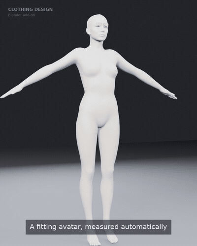
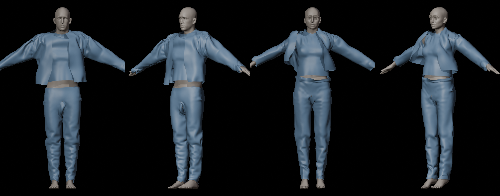

# Clothing Design for Blender

**Draw flat pattern pieces, sew them, and drape them onto your character — a pattern-based garment workflow that lives entirely inside Blender.**

Free and open source. No subscription, no login server, no external dependencies: a pure-Python add-on on top of Blender's own cloth solver.



## What it does

- **Measures your character.** Point it at any rigged body mesh. It takes a stack of cross-sections and the limb axes from the armature, masking the arms and head out by skin weight so a figure with its arms down doesn't measure as having a 112 cm waist.
- **Drafts garments from those measurements.** Nine parametric blocks — T-shirt, tank top, skirt, trousers, jumpsuit, dress, jacket, hoodie, flat panel — drawn the way a pattern cutter would: the neckline is solved to the true neck girth, the armhole to the biceps, and the sleeve cap is solved by bisection so it measures the same as the armhole it's sewn to. A cap longer than its armhole is what gathers a sleeve into a crumpled mess.
- **Knows men from women.** The figure is read off the measured proportions (or set by hand) and each block follows that figure's drafting rules: scooped vs crew neck, sloped vs square shoulder, side seams that curve in at the waist vs straight, hem cut to the hip, trouser rise at the waist vs below it.
- **Lets you draw your own.** Click points on the grid in the 2D pattern view, click the first point to close, name the edges, sew them. Every piece has Width and Length, and a garment has a Size that scales all its pieces together. *Counterpart* mirrors a piece to the other side of the body and stitches the edges that meet — draw the front, get the back.
- **Sews and drapes in three phases.** Stitch (sewing springs pull the seams closed at low gravity), weld (paired seam vertices merge into one continuous surface), settle (full gravity). Welding matters: springs that never stop pulling crush the fabric into wrinkles.
- **Grab tool.** Drag on the garment while it simulates and pull the fabric where you want it.
- **Outfits, layered.** Build a whole outfit at once; each garment sits on its own layer and collides with the body and everything worn under it.
- **Finalize.** Freezes the shape, adds thickness, transfers skin weights from the body (smoothed across neighbours, so the crotch of a jumpsuit doesn't tear when the legs separate) and binds to the rig. The garment follows your animation.



The flat pieces behind that outfit — T-shirt, trousers and jacket — every one drafted from the body in front of it:


## Install

Built and tested on **Blender 5.2**. Nothing else to install.

1. Download this repository as a zip (or clone it).
2. Zip the `clothing_design` folder on its own: `zip -r clothing_design.zip clothing_design -x '*__pycache__*'`
3. Blender: *Edit > Preferences > Add-ons > Install from Disk…*, pick the zip, tick **Clothing Design**.

Developing? Symlink `clothing_design/` into `scripts/addons/` instead and edits are live after *Reload Scripts*.

## Five-minute first garment

1. Sidebar (`N`) > **Clothing** > *Workspace* > **Create Clothing Design Workspace**. You get a 2D pattern view on the left, the 3D body in the middle, the physics panel on the right.
2. *Avatar* > **Default > Woman** (or **Man**). A bundled fitting body is imported, set as the avatar and measured.
3. *Patterns* > **Add Garment** > T-Shirt. Four pieces appear in the 2D view, already arranged around the body and sewn.
4. *Garments* > **Sew**. Watch it stitch, weld and settle.
5. *Finalize* > **Finalize** when you like it.

Then try **Outfit** for a full layered set, or **Draw Pattern** to start from your own pieces. The add-on's own [README](clothing_design/README.md) walks through every tool and the reasoning behind it.

## Garments and outfits

| Garment | Pieces | Notes |
|---|---|---|
| T-Shirt | front, back, two sleeves | sleeve cap solved to the armhole |
| Tank Top | front, back | deeper neck and armhole |
| Skirt | front, back | flared |
| Trousers | hip yoke front/back, four leg panels | the yoke is what keeps them up |
| Jumpsuit | bodice with a split hem, sleeves, four legs | one piece shoulder to ankle |
| Dress | front, back (optional sleeves) | A-line shift |
| Jacket | two front halves, back, long sleeves | open front |
| Hoodie | front, back, sleeves, two-piece hood | hood cut to the neckline it joins |
| Flat Panel | one rectangle | for drawing your own |

Outfits follow the figure. **Man:** Casual, Streetwear, Workwear, Full Layers. **Woman:** Casual, Summer, Dress & Jacket, Streetwear, Workwear.

## Fabric

Four presets — Crisp/Tailored, Soft/Jersey, Stiff/Denim, Light/Silk — set tension, compression, shear and bending together. Bending stiffness is the strongest control over how many folds you get. *Take In* shrinks the fabric onto the body once the seams are welded.

## How it's built

- **Quad grid, not triangles.** Each piece is a structured quad grid clipped to its outline (100 % quads, ~85° minimum corner angle). A quad cage subdivides into a clean surface, and its edges run along the pattern's own axes, so the cloth stretches along the grain like woven fabric instead of isotropically like a membrane.
- **The cloth solves on the cage.** Subdivision sits *after* the cloth modifier, so raising the display level costs almost nothing at simulation time: a tank top drapes in 8 s at subdivision 1 and 15 s at 2 (it was 217 s with the subdivision in front of the cloth).
- **Seams belong to the garment**, not the scene, so you can have several garments and re-sew any of them. **Unsew** rebuilds a garment from its flat pieces so you can edit the draft and try again.
- **Layered collision is one-directional** (outer sees inner, never the reverse), because two cloth objects colliding with each other makes Blender's dependency graph cyclic and it silently drops the relationship.

## Avatars

Two stripped fitting bodies are bundled — Camila and Kevin, 1.4 MB each: no textures, no facial morphs, arms held 60° out, feet on the floor. Garments drape noticeably cleaner with the arms away from the torso. Use your own character with **Set Avatar**; any rigged mesh with a recognisable spine/arm/leg bone naming (CC4, Mixamo, Rigify) measures automatically.

## Known issues

Honest list — it's a 1.0.

- **Tops ride up during the stitch phase.** With the default unlimited sewing force, a hip-length top settles 10–17 cm higher than it was cut, which leaves a gap above the trousers in the outfit render above. The cause is measured (the uncapped springs, and sleeves on a raised arm hoisting the bodice); the fix is in progress. Capping *Sew Force* around 2–5 helps sleeveless garments today.
- Layering is one-way: an outer garment sees the inner ones, inner garments don't react to outer ones.
- No darts, pleats or seam allowance yet in the drawn patterns.
- It is Blender's cloth solver: a full outfit takes a couple of minutes to sew, and results are as good as Blender cloth gets.
- Tested on Blender 5.2 only.

## Testing

```bash
blender -b --python tests/test_presets.py            # both avatars, every preset, seam lengths  (~1 min)
blender -b --python tests/test_presets.py -- --drape  # + sews a T-shirt and trousers on each     (~3 min)
```

## Contributing

Issues and pull requests welcome. If a garment drafts badly on your character, the most useful report is the measurements the Avatar panel shows (height, chest, waist, hip, neck) and which block went wrong. Adding a block is one function in `clothing_design/library.py` that returns pieces and seams — the T-shirt is the one to copy.

## License

GPL-3.0-or-later, like Blender itself.
